# Floci Proof of Concept (PoC) Documentation

**Project:** AI-Agent Data Exfiltration Detection Framework  
**FYP Title:** Design and Evaluation of Monitoring Strategies for Detecting AI-Agent Data Exfiltration under Incomplete Cloud Audit Evidence  
**Status:** FYP1 M1 PoC evidence consolidated; repository-based feasibility assessment complete (cloud storage, audit evidence, receiver, and detector input demonstrated; pending formal supervisor review)  
**Updated:** 2 November 2026 | **Environment:** Windows, Git Bash, Docker, AWS CLI, Python/boto3

---

## 1. Purpose & Scope

This report records the FYP1 M1 feasibility PoC for the local cloud-emulation testbed (Floci):
- S3-compatible synthetic data storage and retrieval (AWS CLI & Python/boto3 agent).
- CloudTrail-format audit event generation and delivery for object-level access.
- Exfiltration to a local HTTP receiver with SHA-256 integrity verification.
- State and audit log persistence across container restarts.
- Experiment storage environment setup (source bucket `fyp-experiment-data` and exfiltration sink bucket `fyp-exfil-sink`).
- Normalization of audit records at the shared detector-input interface (`src/evidence/detector_input.py`) under both complete and degraded evidence conditions.

> **M1 scope:** This is a local synthetic-data PoC confirming baseline feasibility across storage, audit evidence, outbound transfer, and the detector-input normalization boundary. The FYP1 M1 gate requirement to demonstrate cloud storage, audit evidence, receiver transfer, and detector-input handoff is evidenced below. It does not evaluate monitoring strategy detection efficacy or execute multi-scenario matrices; scenario automation and comparative monitor evaluations remain scheduled for subsequent milestones.

---

## 2. Architecture & Pipeline

```text
Synthetic S3 Object (fyp-persistence-test / fyp-experiment-data)
       │
       ▼
Floci S3 API (localhost:4567) ──► S3 Audit Logs (fyp-poc-trail)
       │                                  │
       ▼                                  ▼
Python Agent (boto3)             CloudTrail Inspector / Log Sync
       │ HTTP POST /transfer              │
       ▼                                  ▼
Local Receiver (127.0.0.1:8080)  to_detector_input() (src/evidence/detector_input.py)
       │                                  │
       ▼                                  ▼
Transfers JSONL + SHA-256        Normalized Monitor Evidence (Complete / Degraded)
```

CloudTrail records are synced to local compressed JSON files and inspected with `scripts/inspect_cloudtrail.py`. The pipeline connects audit events to the monitoring boundary via `src/evidence/detector_input.py`, converting raw and degraded CloudTrail logs into normalized detector input records while isolating experiment provenance.

### 2.1 Floci Container & Volume Setup
Persistent container `floci-persistent` mapped to port `4567` (`FLOCI_STORAGE_MODE=persistent`, `/app/data` mounted on named volume `floci-persistent-data`).

> **Evidence (SS-01 - Container & Volume Setup):**  
> 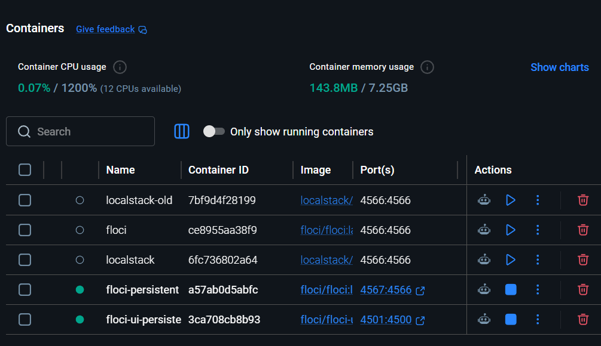

### 2.2 Components Summary

| Component | Identifier / Path | Purpose |
| :--- | :--- | :--- |
| **Emulator** | Container `floci-persistent` (port `4567`) | Local S3/CloudTrail emulator (vol: `floci-persistent-data`) |
| **PoC Storage** | Bucket `fyp-persistence-test` | Stores synthetic baseline object & CloudTrail audit logs |
| **Experiment Source** | Bucket `fyp-experiment-data` | Target source bucket for experiment data retrieval and monitoring |
| **Experiment Sink** | Bucket `fyp-exfil-sink` | Target exfiltration sink bucket for cloud-side exfiltration testing |
| **Test Objects** | `synthetic/test-data.txt`<br>`synthetic/experiment-test-data.txt` | 75-byte synthetic payloads |
| **Audit Trail** | `fyp-poc-trail` (region `us-east-1`) | Captures management & S3 data events (`GetObject`) |
| **Agent** | `src/agent/agent.py` | Retrieves object via boto3 and forwards to receiver |
| **Receiver** | `src/receiver/server.py` | Accepts POST payload (≤1 MiB) & logs transfer metadata |
| **Telemetry** | `poc-data/agent-logs/agent-runs.jsonl`<br>`poc-data/receiver-logs/transfers.jsonl` | Agent run logs and receiver-side integrity records |
| **Audit Logs** | `poc-data/cloudtrail-logs/` | Synced compressed JSON log evidence (PoC and experiment runs) |
| **Inspector** | `scripts/inspect_cloudtrail.py` | Deduplicates and parses CloudTrail S3 events |
| **Log Degrader** | `scripts/degrade_cloudtrail.py` | Applies realistic audit degradations (bucket stripping, time rounding, masking) |
| **Detector Input** | `src/evidence/detector_input.py` | Normalizes complete and degraded audit logs into detector evidence |
| **Unit Tests** | `tests/test_detector_input.py` | Verifies field extraction, null handling, and masked identity parsing |

---

## 3. Synthetic Test Payload

- **PoC S3 Key:** `synthetic/test-data.txt` (Bucket: `fyp-persistence-test`)
- **Experiment S3 Key:** `synthetic/experiment-test-data.txt` (Buckets: `fyp-experiment-data`, `fyp-exfil-sink`)
- **Size:** 75 bytes
- **SHA-256:** `1819059edc21d93eebbe0c452a51a6d6d43923833c3140a5f9939f36b5aa5276`
- **Content:**
  ```text
  SYNTHETIC TEST DATA ONLY
  Record A: demo-value-001
  Record B: demo-value-002
  ```

---

## 4. Configuration & Verification Commands

### 4.1 Verify STS Identity
```bash
aws --endpoint-url=http://localhost:4567 sts get-caller-identity
```
> **Evidence (SS-02 - Floci API Identity):**  
> 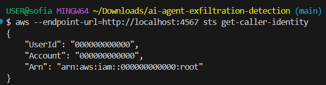

### 4.2 Verify S3 Object Retrieval
```bash
aws --endpoint-url=http://localhost:4567 s3api get-object \
  --bucket fyp-persistence-test \
  --key synthetic/test-data.txt /tmp/floci-persistence-test.txt
```
> **Evidence (SS-03 - Synthetic S3 Object Retrieval):**  
> 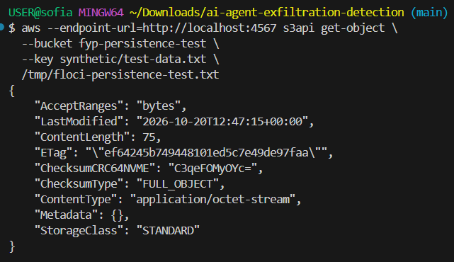

### 4.3 Configure & Verify CloudTrail

Initial trail configuration and event selector setup for baseline PoC:
```bash
# Set event selectors for S3 object-level data events
aws --endpoint-url=http://localhost:4567 cloudtrail put-event-selectors \
  --trail-name fyp-poc-trail --region us-east-1 \
  --event-selectors '[{"ReadWriteType":"All","IncludeManagementEvents":true,"DataResources":[{"Type":"AWS::S3::Object","Values":["arn:aws:s3:::fyp-persistence-test/"]}]}]'

# Describe trail configuration
aws --endpoint-url=http://localhost:4567 cloudtrail describe-trails --region us-east-1
```
> **Evidence (SS-04 - CloudTrail Trail Configuration):**  
> 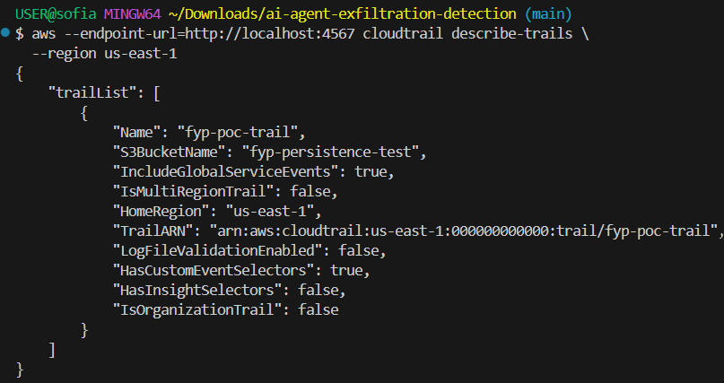

```bash
# Check trail logging status
aws --endpoint-url=http://localhost:4567 cloudtrail get-trail-status --name fyp-poc-trail --region us-east-1
```
> **Evidence (SS-05 - CloudTrail Logging Enabled):**  
> 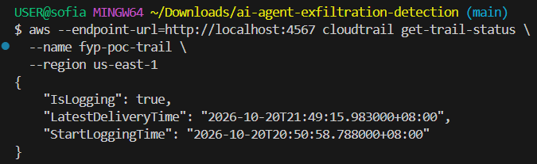

Verification of existing active trail configuration:
```bash
E="--endpoint-url=http://localhost:4567"
aws $E cloudtrail describe-trails \
  --trail-name-list fyp-poc-trail \
  --region us-east-1
```
> **Evidence (SS-11 - CloudTrail Existing Trail Configuration):**  
> 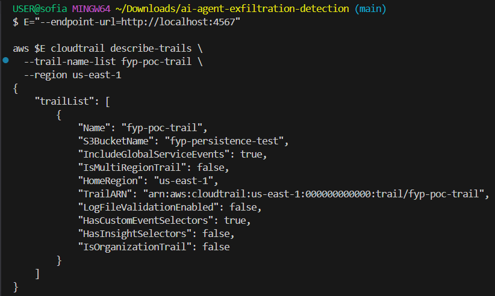

Verification of baseline trail event selectors:
```bash
aws $E cloudtrail get-event-selectors \
  --trail-name fyp-poc-trail \
  --region us-east-1
```
> **Evidence (SS-12 - CloudTrail Event Selectors):**  
> 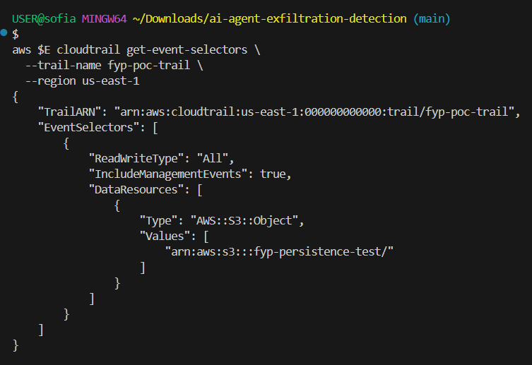

> **Selector State Verification:** As captured in SS-12 and preserved in `poc-data/cloudtrail-backup/fyp-poc-trail-selectors-before.json`, the initial trail selector logged only `arn:aws:s3:::fyp-persistence-test/`. To capture object-level access for experiment operations, the selector was subsequently updated (see Section 4.5).

### 4.4 CloudTrail Log Sync & Inspection
```bash
aws --endpoint-url=http://localhost:4567 s3 sync s3://fyp-persistence-test/AWSLogs/ poc-data/cloudtrail-logs/AWSLogs/
python scripts/inspect_cloudtrail.py --target old-poc
```
Use `--target experiment` (the default) for the experiment bucket. The older screenshots and event table in this report refer to the `old-poc` target.

> **Evidence (SS-08 - CloudTrail GetObject Events):**  
> 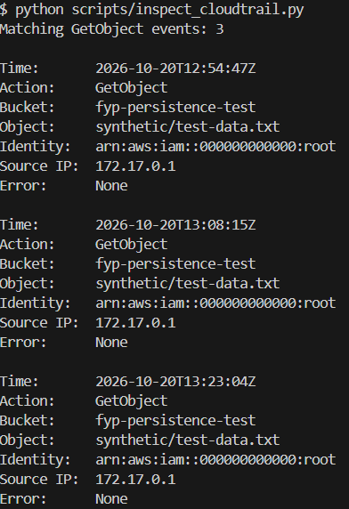

### 4.5 Experiment Storage Setup (Buckets & Objects)

To support broader experiment scenarios and evaluation, two dedicated experiment buckets were created and verified: `fyp-experiment-data` (source data) and `fyp-exfil-sink` (exfiltration target).

Create the experiment source bucket:
```bash
aws --endpoint-url=http://localhost:4567 s3 mb s3://fyp-experiment-data --region us-east-1
```
> **Evidence (SS-13 - Source Bucket Created):**  
> 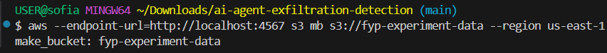

Create the experiment exfiltration sink bucket:
```bash
aws --endpoint-url=http://localhost:4567 s3 mb s3://fyp-exfil-sink --region us-east-1
```
> **Evidence (SS-14 - Exfiltration Sink Bucket Created):**  
> 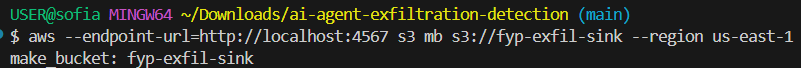

Verify bucket existence and region configuration:
```bash
aws --endpoint-url=http://localhost:4567 s3 ls
aws --endpoint-url=http://localhost:4567 s3api head-bucket --bucket fyp-experiment-data
aws --endpoint-url=http://localhost:4567 s3api head-bucket --bucket fyp-exfil-sink
```
> **Evidence (SS-15 - Experiment Buckets Verified):**  
> 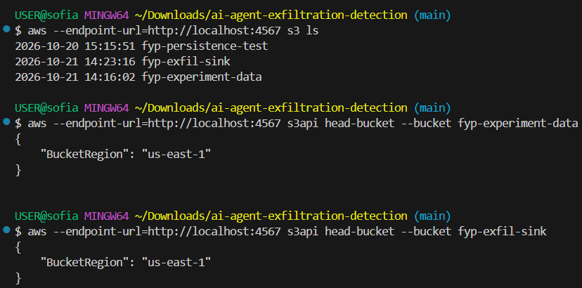

Verify upload and presence of synthetic test payloads in both experiment buckets:
```bash
aws --endpoint-url=http://localhost:4567 s3 ls s3://fyp-experiment-data/synthetic/ --region us-east-1
aws --endpoint-url=http://localhost:4567 s3 ls s3://fyp-exfil-sink/synthetic/ --region us-east-1
```
> **Evidence (SS-16 - Experiment Objects Uploaded):**  
> 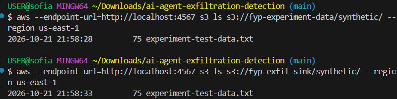

#### Event Selector Update for Experiment Buckets
To capture object-level `GetObject` events across both baseline and experiment buckets, the trail selectors were updated using the configuration stored in `poc-data/cloudtrail-backup/fyp-poc-trail-selectors-updated.json`:
```json
{
  "TrailName": "fyp-poc-trail",
  "EventSelectors": [
    {
      "ReadWriteType": "All",
      "IncludeManagementEvents": true,
      "DataResources": [
        {
          "Type": "AWS::S3::Object",
          "Values": [
            "arn:aws:s3:::fyp-persistence-test/",
            "arn:aws:s3:::fyp-experiment-data/",
            "arn:aws:s3:::fyp-exfil-sink/"
          ]
        }
      ]
    }
  ]
}
```
Applying this updated selector configuration enabled the capture of the 5 experiment `GetObject` events detailed in Section 5.1.2.

---

## 5. Test Results & Observed Evidence

### 5.1 CloudTrail Object Access Events

The audit evidence is organized into two distinct sets: the initial baseline persistence PoC dataset and the subsequent experiment dataset.

#### 5.1.1 Baseline Persistence PoC Access Events (20 October 2026)
Inspected via `python scripts/inspect_cloudtrail.py --target old-poc` against bucket `fyp-persistence-test`:

| Event Time (UTC) | Action | Resource | Identity | Error | Notes |
| :--- | :--- | :--- | :--- | :--- | :--- |
| `2026-10-20T12:54:47Z` | `GetObject` | `fyp-persistence-test / synthetic/test-data.txt` | `arn:aws:iam::000000000000:root` | `None` | Initial CLI verification |
| `2026-10-20T13:08:15Z` | `GetObject` | `fyp-persistence-test / synthetic/test-data.txt` | `arn:aws:iam::000000000000:root` | `None` | Pre-restart baseline agent access |
| `2026-10-20T13:23:04Z` | `GetObject` | `fyp-persistence-test / synthetic/test-data.txt` | `arn:aws:iam::000000000000:root` | `None` | Post-restart persistence verification |

*Cross-reference:* Captured in SS-08.

#### 5.1.2 Experiment Data Access Events (27 October 2026)
Inspected via `python scripts/inspect_cloudtrail.py --target experiment` against bucket `fyp-experiment-data` across 178 log files:

| Event Time (UTC) | Action | Resource | Identity | Error | User Agent / Origin |
| :--- | :--- | :--- | :--- | :--- | :--- |
| `2026-10-27T10:06:26Z` | `GetObject` | `fyp-experiment-data / synthetic/experiment-test-data.txt` | `arn:aws:iam::000000000000:root` | `None` | `aws-cli/2.36.24` (Setup / validation access) |
| `2026-10-27T10:55:33Z` | `GetObject` | `fyp-experiment-data / synthetic/experiment-test-data.txt` | `arn:aws:iam::000000000000:user/experiment-agent` | `None` | `Boto3/1.43.115` (Agent test execution) |
| `2026-10-27T11:00:06Z` | `GetObject` | `fyp-experiment-data / synthetic/experiment-test-data.txt` | `arn:aws:iam::000000000000:user/experiment-agent` | `None` | `Boto3/1.43.115` (Agent run) |
| `2026-10-27T11:00:21Z` | `GetObject` | `fyp-experiment-data / synthetic/experiment-test-data.txt` | `arn:aws:iam::000000000000:user/experiment-agent` | `None` | `Boto3/1.43.115` (Agent run) |
| `2026-10-27T11:01:40Z` | `GetObject` | `fyp-experiment-data / synthetic/experiment-test-data.txt` | `arn:aws:iam::000000000000:user/experiment-agent` | `None` | `Boto3/1.43.115` (Agent transfer run) |

All 5 events recorded 75 bytes transferred out with no recorded errors. The first event captures the initial CLI setup access as `root`, while the subsequent four events record agent programmatic accesses under `arn:aws:iam::000000000000:user/experiment-agent`.

### 5.2 Agent-to-Receiver Transfer

| Metric | Agent (`agent-runs.jsonl`) | Receiver (`transfers.jsonl`) |
| :--- | :--- | :--- |
| **Run ID / Status** | `20261020T130815222751Z` / `200 accepted` | Request accepted (`POST /transfer`) |
| **Bytes Transferred** | 75 bytes | 75 bytes |
| **Payload Hash** | `1819059edc21d93eebbe0c452a51a6d6d43923833c3140a5f9939f36b5aa5276` | `1819059edc21d93eebbe0c452a51a6d6d43923833c3140a5f9939f36b5aa5276` |

*Integrity verified:* Exact byte size and SHA-256 match confirmed across agent transmission and receiver reception.

The committed experiment logs also contain a 27 October 2026 run (`20261027T110141060847Z`) with a 75-byte payload, HTTP 200 response, and matching SHA-256 at the receiver. The repository contains two agent-run records and three receiver records overall. **These logs do not share a common run ID, so they do not establish one-to-one joins for every transfer and CloudTrail event.**

> **Evidence (SS-06 - Agent Run Success):**  
> 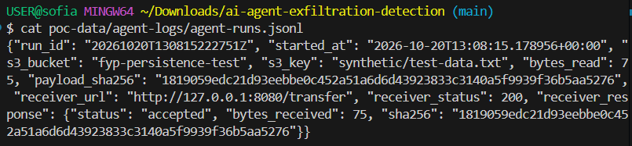

> **Evidence (SS-07 - Receiver Hash Match):**  
> 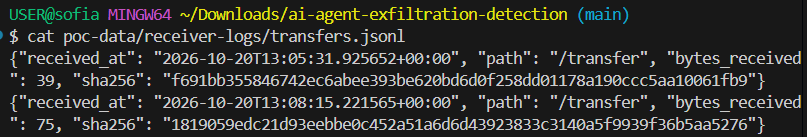

### 5.3 Persistence Verification (Container Restart)
Execute container restart:
```bash
docker restart floci-persistent
```
> **Evidence (SS-09 - Persistence After Restart):**  
> 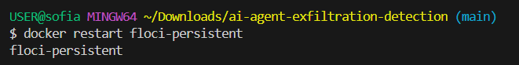

Post-restart verification and log sync:
```bash
# Sync logs after post-restart object access
aws --endpoint-url=http://localhost:4567 s3 sync s3://fyp-persistence-test/AWSLogs/ poc-data/cloudtrail-logs/AWSLogs/
python scripts/inspect_cloudtrail.py
```
> **Evidence (SS-10 - Post-Restart Log Sync & Verification):**  
> 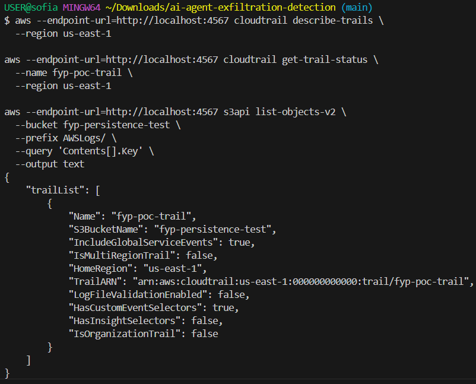

1. **API Reachability:** STS caller identity responded immediately after restart.
2. **Trail Configuration:** `fyp-poc-trail` remained configured and active (`IsLogging: true`).
3. **Data & Audit Persistence:** Historical logs remained accessible; new post-restart access (`13:23:04Z`) was captured and synced successfully.

### 5.4 Detector-Input Evidence Normalization & Validation

A minimal detector-input interface was implemented in `src/evidence/detector_input.py` to normalize raw CloudTrail S3 `GetObject` events into a consistent evidence structure for downstream monitoring strategies.

The interface (`to_detector_input`) extracts the following fields:
- `event_time`: Event timestamp (ISO 8601 UTC)
- `action`: API action name (`eventName`)
- `bucket`: S3 bucket name (`requestParameters.bucketName`)
- `object_key`: S3 object key (`requestParameters.key`)
- `identity`: IAM identity ARN (`userIdentity.arn`)
- `source_ip`: Client IP address (`sourceIPAddress`)
- `bytes_transferred_out`: Data size (`additionalEventData.bytesTransferredOut`)
- `error_code`: Error code, if any (`errorCode`)

Missing fields are represented strictly as `None` (or `null` in JSON). The interface performs no detection inferences or synthetic field fabrication.

#### 5.4.1 Complete-Event Normalization
When parsing complete audit events, all fields—including exact bucket names and unmasked IAM user ARNs—are extracted accurately into the detector schema:

> **Evidence (SS-17 - Complete Event Detector Input):**  
> 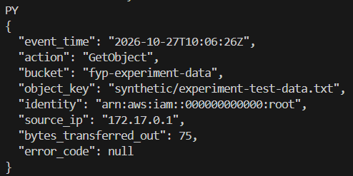

#### 5.4.2 Degraded-Event Normalization & Provenance Isolation
To model realistic incomplete audit conditions (e.g. log sanitization, coarse timestamping, or identity masking), `scripts/degrade_cloudtrail.py` generates degraded audit events under controlled conditions:
1. **Bucket name removed:** `bucket` evaluates to `null`.
2. **Timestamp coarsened:** Seconds and microseconds are zeroed to minute precision (e.g. `10:06:00Z`).
3. **Identity masked:** Specific IAM ARN is replaced with `MASKED`.

Experiment provenance (such as `source_file` and `source_record_index`) is retained in an external envelope for experiment tracking and validation, and is cleanly isolated from the monitor input:

> **Evidence (SS-18 - Degraded Event Detector Input):**  
> 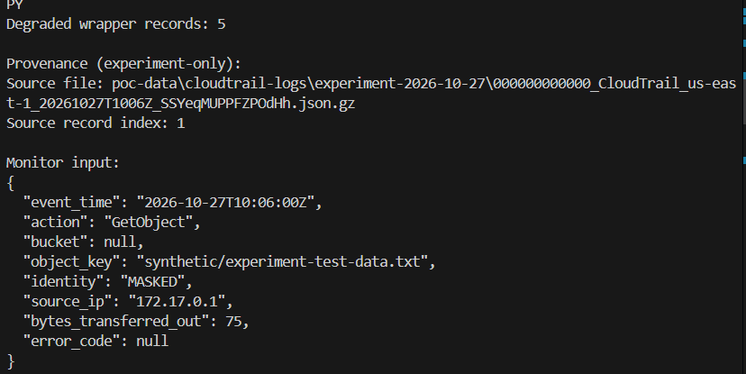

#### 5.4.3 Validation & Test Results
The detector-input transformation and degradation integrity were verified via automated unit tests (`tests/test_detector_input.py`) and degradation validation routines (`scripts/degrade_cloudtrail.py`):

| Test / Check | Result | Details |
| :--- | :--- | :--- |
| **Complete-event conversion** | Passed | Normalized all fields (bucket, key, ARN, IP, bytes, null error) |
| **Degraded-event conversion** | Passed | Handled missing bucket (`null`), masked identity, and minute-level timestamp |
| **Missing bucket handling** | Passed | Missing `bucketName` safely normalizes to `None` without exceptions |
| **Masked identity handling** | Passed | Correctly extracts and retains masked identity string |
| **Unit test suite** | 2 passed | `tests/test_detector_input.py` executed cleanly via `unittest` |
| **Actual degraded records checked** | 5 | All 5 matching events from experiment logs degraded accurately |
| **Degradation validation errors** | 0 | Only intended degradation changes occurred |
| **Source file integrity** | Unchanged | Verified SHA-256 match across all 66 source log files |

> **Evidence (SS-19 - Degradation Validation Output):**  
> 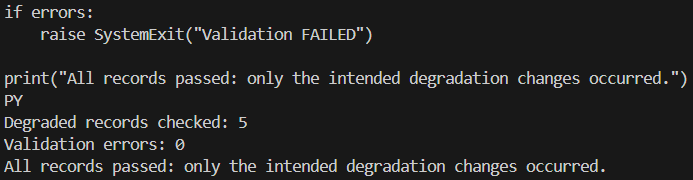

The degradation validation confirmed that the intended transformations were applied consistently while preserving other event fields and leaving the source audit logs unmodified. This successfully establishes the normalized evidence boundary for subsequent monitor implementation.

---

## 6. Feasibility Limitations & Mitigations

1. **IAM Enforcement Limitation:** During PoC testing, S3 access did not consistently follow expected IAM policy restrictions. The behavior may be related to Floci IAM enforcement configuration and was not conclusively established as an emulator limitation. IAM enforcement is not a core experimental variable in this FYP, which evaluates detection rather than prevention. Therefore, the experiment will use controlled scripted agent behavior and document this limitation.
2. **Run ID & Correlation Limitation:** Agent logs and receiver transfer logs do not share a common run ID with CloudTrail audit records. While payload sizes and SHA-256 hashes confirm transmission integrity, these logs do not establish one-to-one joins across every individual transfer and audit event.
3. **Emulator Boundary:** Floci emulates S3 and CloudTrail behaviors locally. This PoC validates testbed feasibility and evidence normalization, but does not claim equivalence to high-scale production AWS environments or evaluate monitor detection effectiveness.

---

## 7. Evidence & Screenshot Checklist

All screenshot evidence is stored in `docs/poc/evidences/` and embedded under the corresponding command/section:

| ID | Filename | Description | Location in Document | Priority |
| :--- | :--- | :--- | :--- | :--- |
| **SS-01** | `01-floci-container-volume.png` | Container & volume in Docker / terminal | [Section 2.1](#21-floci-container--volume-setup) | Recommended |
| **SS-02** | `02-floci-api-identity.png` | `sts get-caller-identity` output | [Section 4.1](#41-verify-sts-identity) | **Core** |
| **SS-03** | `03-synthetic-s3-object.png` | S3 `get-object` showing 75-byte length | [Section 4.2](#42-verify-s3-object-retrieval) | Optional |
| **SS-04** | `04-cloudtrail-trail-config.png` | Initial `describe-trails` output | [Section 4.3](#43-configure--verify-cloudtrail) | **Core** |
| **SS-05** | `05-cloudtrail-logging-enabled.png` | `get-trail-status` showing `IsLogging: true` | [Section 4.3](#43-configure--verify-cloudtrail) | **Core** |
| **SS-06** | `06-agent-success.png` | Agent run log (75 bytes, HTTP 200) | [Section 5.2](#52-agent-to-receiver-transfer) | **Core** |
| **SS-07** | `07-receiver-hash-match.png` | Receiver JSONL log with matching SHA-256 | [Section 5.2](#52-agent-to-receiver-transfer) | **Core** |
| **SS-08** | `08-cloudtrail-getobject-events.png` | Inspector output with 3 `GetObject` events | [Section 4.4](#44-cloudtrail-log-sync--inspection) | **Core** |
| **SS-09** | `09-persistence-after-restart.png` | `docker restart` + active trail status | [Section 5.3](#53-persistence-verification-container-restart) | **Core** |
| **SS-10** | `10-post-restart-log-sync.png` | S3 sync showing logs after restart | [Section 5.3](#53-persistence-verification-container-restart) | Optional |
| **SS-11** | `11-cloudtrail-existing-trail.png` | Verified existing trail `fyp-poc-trail` configuration | [Section 4.3](#43-configure--verify-cloudtrail) | **Core** |
| **SS-12** | `12-cloudtrail-event-selector.png` | Verified trail event selectors for S3 object logging | [Section 4.3](#43-configure--verify-cloudtrail) | **Core** |
| **SS-13** | `13-source-bucket-created.png` | Creation of experiment source bucket `fyp-experiment-data` | [Section 4.5](#45-experiment-storage-setup-buckets--objects) | **Core** |
| **SS-14** | `14-exfil-sink-bucket-created.png` | Creation of experiment sink bucket `fyp-exfil-sink` | [Section 4.5](#45-experiment-storage-setup-buckets--objects) | **Core** |
| **SS-15** | `15-experiment-buckets-verified.png` | Bucket list and region verification (`head-bucket`) | [Section 4.5](#45-experiment-storage-setup-buckets--objects) | **Core** |
| **SS-16** | `16-experiment-objects-uploaded.png` | Upload verification of 75-byte synthetic payloads | [Section 4.5](#45-experiment-storage-setup-buckets--objects) | **Core** |
| **SS-17** | `17-complete-detector.png` | Normalized detector input for complete CloudTrail event | [Section 5.4](#54-detector-input-evidence-normalization--validation) | **Core** |
| **SS-18** | `18-degraded-detector.png` | Normalized detector input for degraded event with provenance | [Section 5.4](#54-detector-input-evidence-normalization--validation) | **Core** |
| **SS-19** | `19-degradation-validation.png` | Automated degradation validation output (5 records, 0 errors) | [Section 5.4](#54-detector-input-evidence-normalization--validation) | **Core** |

---

## 8. FYP1 M1 Checklist and Feasibility Assessment

The project Gantt places FYP1 M1 at W4 and names the deliverable “PoC checklist and evidence.” Its gate is a proof of concept connecting cloud storage, audit evidence, receiver, and detector input. Status below is based on the evidence committed in this repository; it confirms that all required components are implemented, tested, and evidenced.

| M1 acceptance item | Status | Evidence / details |
| :--- | :--- | :--- |
| Local Floci environment and persistent state demonstrated | **Complete** | SS-01, SS-02, SS-09, and SS-10 document the container, API identity, restart, and post-restart state. |
| Synthetic S3 object is available and retrievable | **Complete** | SS-03 and SS-16 document 75-byte synthetic object retrieval and deployment across buckets. |
| CloudTrail object-level logging and `GetObject` evidence demonstrated | **Complete** | SS-04, SS-05, SS-11, and SS-12 document trail configuration and active selectors; SS-08 and Section 5.1 record matching object-read events across PoC and experiment datasets. |
| Outbound receiver accepts the agent payload and verifies integrity | **Complete** | SS-06 and SS-07 document the 75-byte transfer, HTTP success, and matching SHA-256. Committed experiment logs also contain matching transfer runs. |
| Experiment storage environment prepared | **Complete** | SS-13, SS-14, SS-15, and SS-16 document the creation and verification of `fyp-experiment-data` and `fyp-exfil-sink` buckets and object deployment. |
| Shared detector-input boundary is demonstrated | **Complete** | Implemented in `src/evidence/detector_input.py`, tested via `tests/test_detector_input.py` (2 unit tests passed), verified with complete events (SS-17) and degraded events with provenance separation (SS-18, SS-19). Normalized fields conform to the shared monitor input schema. |
| M1 checklist and feasibility assessment recorded | **Complete** | All M1 gate criteria evidenced; documented in this report for supervisor review. |

### Feasibility decision

**Repository-based assessment: Feasibility demonstrated.** The committed evidence demonstrates the technical feasibility of the local emulation testbed across cloud storage, audit event capture, outbound agent transfer, container persistence, and detector-input normalization under complete and degraded conditions. The PoC supports progression to monitor implementation and pilot testing, subject to supervisor review and milestone acceptance.

This is a feasibility assessment confirming that foundational testbed pipelines are operational. The current evidence is based on a local emulator, synthetic payloads, and a controlled PoC record set. It does not evaluate monitoring strategy detection effectiveness, scenario coverage, or experiment results. This assessment does not alter the approved research question, fixed scripted-agent role, three scenarios, two evidence conditions, four monitoring strategies, or planned 520-run matrix. Full monitor evaluation and comparative detection experiments remain scheduled for subsequent milestone phases.

### M1 close-out actions

1. **Detector-input connection:** Connected via `src/evidence/detector_input.py`, mapping verified CloudTrail events into the normalized schema (`event_time`, `action`, `bucket`, `object_key`, `identity`, `source_ip`, `bytes_transferred_out`, `error_code`). Demonstrated for both complete baseline evidence and degraded evidence.
2. **Provenance separation:** Provenance data (`source_file`, `source_record_index`) is retained externally in wrapper records and kept strictly isolated from the monitor evidence.
3. **Checklist verification:** All M1 acceptance criteria have been evidenced and recorded for team and supervisor review.

